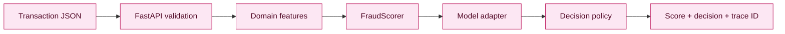

<div align="center">

# RAQIB
### Fraud Scoring, Engineered with Care

A notebook-to-service engineering project by **Jana Alhumaizi**<br>
**SDAIA Academy · SDA-AIE-113 · Individual submission**

[](https://github.com/jnjnmaizi/JanaAlhuamizi_SDA-AIE-113_WorkShop/actions/workflows/ci.yml)


[Run it](#quick-start) · [Architecture](#architecture) · [Evidence](docs/EVIDENCE.md) · [Journal](JOURNAL.md)

</div>

Raqib validates a transaction, computes model features, predicts a fraud score and applies an **allow / review / block** policy. The project demonstrates six engineering modules through seven lab sessions, including 2a and 2b.

> **Scope:** this repository implements the workshop labs using **5,000 synthetic transactions**. The instructor approved Raqib as the author’s individual final submission, as confirmed by Jana. It is an educational service, not a live payment system.

## Quick start

### Docker

```bash
git clone https://github.com/jnjnmaizi/JanaAlhuamizi_SDA-AIE-113_WorkShop.git
cd JanaAlhuamizi_SDA-AIE-113_WorkShop
docker compose up --build -d
docker compose ps
```

Open [Swagger UI](http://localhost:8000/docs). Wait until the API is healthy. Stop with `docker compose down`.

### Python 3.12

```bash
python3.12 -m venv .venv
source .venv/bin/activate
python -m pip install -e ".[dev]"
cp configs/settings.example.env .env
python -m uvicorn fraud_service.api.app:create_app --factory --reload --no-access-log
```

Run from the repository root. On Windows, create the environment with `py -3.12 -m venv .venv`, activate with `.venv\Scripts\activate`, and copy the settings with `Copy-Item configs/settings.example.env .env`. Never commit real credentials.

### Send a transaction

```bash
curl -s http://localhost:8000/v1/predict \
  -H "Content-Type: application/json" \
  -H "X-Trace-Id: jana-demo-001" \
  -d @payloads/sample.json
```

On Windows PowerShell, use `curl.exe` or Swagger UI.

```json
{
  "transaction_id": "TXN-2026-00042",
  "amount_sar": 249.99,
  "channel": "ecom",
  "merchant_category": "electronics",
  "customer_id": "CUST-00077",
  "timestamp": "2026-07-05T03:30:00+00:00"
}
```

Verified response from the local container (trace ID set by the caller):

```json
{
  "transaction_id": "TXN-2026-00042",
  "fraud_probability": 0.62614,
  "decision": "allow",
  "model_version": "v3.2.0",
  "trace_id": "jana-demo-001"
}
```

A negative amount returns HTTP 422:

```json
{
  "error": {
    "code": "INVALID_REQUEST",
    "message": "Request body failed validation",
    "trace_id": "jana-demo-001",
    "details": [{"field": "amount_sar", "problem": "Input should be greater than 0"}]
  }
}
```

| Endpoint | Purpose |
|---|---|
| `POST /v1/predict` | Validate and score one transaction |
| `GET /v1/health` | Process liveness and code revision |
| `GET /v1/ready` | Model readiness; otherwise 503 with `Retry-After` |
| `GET /docs` | Interactive request and response documentation |

Timestamps must be ISO-8601 strings with a timezone. Features use **UTC**, matching the training data. This deliberately rejects naive dates and numeric epochs. Extra fields are rejected. Trace IDs appear in responses and structured request logs.

## Architecture



| Layer | Responsibility | Source |
|---|---|---|
| Domain | Transactions, UTC features, decision thresholds | [domain](src/fraud_service/domain/) |
| Service | Model protocol and scoring orchestration | [service](src/fraud_service/service/) |
| Adapter | Load the model and translate features | [sklearn_model.py](src/fraud_service/adapters/sklearn_model.py) |
| API | HTTP contract, warm-up, errors and tracing | [api](src/fraud_service/api/) |
| Configuration | Validate settings before serving | [config.py](src/fraud_service/config.py) |
| Logging | JSON events and recursive key masking | [logging_setup.py](src/fraud_service/logging_setup.py) |

Inner layers do not import outer layers; `lint-imports` enforces this. The batch entrypoint and API reuse the same scorer.

Default decisions: **allow < 0.70**, **review ≥ 0.70 and < 0.85**, **block ≥ 0.85**. The block threshold is configurable; the review band is 0.15.

## Model and limitations

- The actual estimator is scikit-learn's **HistGradientBoostingClassifier**, with a preprocessing pipeline. `fraud_xgb_v3.joblib` is the inherited filename, not an XGBoost claim.
- Data and labels are synthetic, generated by [the course asset script](scripts/make_course_assets.py). Golden scores prove regression consistency, not accuracy on unseen real payments.
- Inputs: log amount, channel, merchant category, UTC hour and night flag. Identifiers are not model features.
- Redis in Compose is a health-dependency exercise; prediction does **not** read from Redis yet.
- An explanation engine and real-data training are possible future extensions; they are outside the approved Raqib submission scope.

## Verify the service

```bash
make lint
make test                         # includes the complete golden regression
make golden                       # batch output, then exact ID/score validation
make hooks                        # install the local Gitleaks pre-commit hook
```

Without Make, run the commands in [Makefile](Makefile) directly in the activated environment.

Tests cover decision boundaries, feature invariance, malformed requests, startup, error privacy, timezone equivalence, nested secret masking, and incomplete/duplicate/invalid golden outputs. Coverage includes branches but currently excludes the batch entrypoint; `make golden` exercises that separately.

CI runs lint, the full test suite, secret scanning, a container smoke test and a **600,000,000-byte uncompressed image-size gate**. Only successful pushes to `main` publish the image. Nightly repeats the full suite. [Workflow](.github/workflows/ci.yml) · [Evidence and pending checks](docs/EVIDENCE.md)

Published image address:

```bash
docker pull ghcr.io/jnjnmaizi/janaalhuamizi_sda-aie-113_workshop:main
```

For a reproducible release, use the commit tag or registry digest. A successful publish does not prove anonymous pull permissions; those depend on package visibility.

## Workshop evidence

| Lab | Implementation | Evidence |
|---|---|---|
| 1 · Refactor | Layers, model protocol, batch scoring | Golden regression and import contract |
| 2a · Serve | Prediction, health and readiness | API integration tests |
| 2b · Harden | Warm-up, safe errors, tracing | Integration tests and [benchmarks](BENCHMARKS.md) |
| 3 · Containerise | Multi-stage, non-root, Compose | CI smoke test and size gate |
| 4 · Test | Unit, integration, model behaviour | Full CI suite and coverage artifact |
| 5 · Automate | Checks and registry publishing | Actions; branch protection still requires setup |
| 6 · Secure | Typed config, masked logs, scanning | Regression tests and [incident plan](INCIDENT.md) |

Historical measurements remain in [BENCHMARKS.md](BENCHMARKS.md); they are not promises for other machines. Updated verification is recorded separately in [docs/EVIDENCE.md](docs/EVIDENCE.md).

## Security and contribution

No real secret is required to run this workshop service. Use local environment variables or a runtime secret store if credentials are added. The registry pipeline uses the short-lived built-in `GITHUB_TOKEN` with publishing permissions confined to its publish job. Do not put secrets in message strings: masking is a safety net for structured keys, not a guarantee for arbitrary text. Unexpected exceptions log their type, not their value or local variables.

Install the pre-commit hook before contributing. Open a PR and wait for the checks. The repository owner must enable required checks and branch protection: [exact setup checklist](docs/EVIDENCE.md#repository-settings).

---

**Built by Jana Alhumaizi** · [Workshop](https://aie113.ibrahimalshehri.sa/) · [Original labs](https://github.com/snow10100/fraud-service/tree/main/labs) · [Final-project guide](https://github.com/snow10100/aie113-projects)
